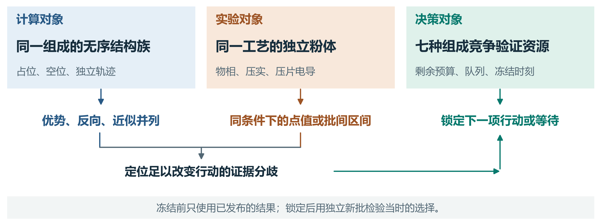

# 氯富集硫银锗矿的概率排序与资源受限研发决策

**当七个配方只剩一个独立新批确认名额，应该给谁？** 本研究以氯富集硫银锗矿 Li₆₋ₓPS₅₋ₓCl₁₊ₓ 为例，考察一个实验室如何利用构型、模拟和压片证据，在期限内决定补测、等待、并行或锁定配方。当前研究版本为 **P9.1**。

**阅读报告**　[正文 PDF](p9/交付稿/开题报告_P9.pdf) · [可在线阅读的全文](p9/paper/开题报告_P9_文稿.md) · [可编辑 Word](p9/交付稿/开题报告_P9.docx)

**准备汇报**　[汇报 PDF](p9/交付稿/汇报版开题报告_P9.pdf) · [可编辑 PowerPoint](p9/交付稿/汇报版开题报告_P9.pptx) · [逐页讲稿](p9/交付稿/P9_逐页汇报词.docx)

## 从哪个结果读起

| 想回答的问题 | 当前证据 | 复核入口 |
| --- | --- | --- |
| 已测过的配方如何排序？ | Mo 等的同系列压片在 25 ℃ 下，x＝0.4 为 8.2 mS/cm，x＝0.5 为 5.9 mS/cm。原表未报告独立批间误差。 | [七个实测点](p9/evidence/mo_s1.csv) · [实验条件与来源](p9/evidence/MO_BENCHMARK.md) |
| 同一配方有多种结构时，怎样比较晶内输运？ | 用结构证据更新各族权重，再计算两配方的优势、反向优势和近似并列概率。目前的代码用明确标记的合成输入验证这一步。 | [排序方法](p9/ranking/README.md) · [三态概率表](p9/ranking/outputs/pairwise.csv) |
| 冻结前再等一份报告，值不值得？ | 在 1,024 个配对情景中，两步前瞻比单步平均少花 221.24 情景元。确认成功率差为 +0.49 个百分点，95% 配对区间为 −0.91 至 +1.88 个百分点。 | [系统试验](simulation/redesign/README.md) · [配对比较](simulation/redesign/outputs/paired_effects.csv) · [一次实际运行的事件流水](simulation/redesign/outputs/events.csv) |
| 如何转入物理验证？ | 方案区分同粉分样和独立新批，并为原子层验收留出参考标签。新批实验、真实 DPA4 训练及宜宾现场节拍校准仍待开展。 | [实验与验收协议](p9/protocol/VALIDATION.md) · [现场待核实项](p9/evidence/site_calibration.csv) |

## 在本地复核

克隆仓库后，在仓库根目录使用 Python 3.11 或更高版本运行以下命令。它们可以复核已发布数据、排序和仿真，无需 GPU 或 Office。

~~~bash
python -m pip install -r requirements.txt
python -m unittest discover -s p9/ranking -p "test_*.py"
python simulation/redesign/verify.py
python p9/paper/verify_p9.py
~~~

要查看独立新批怎样改变一次提名，可从[代表性回放](simulation/redesign/results.md)进入；要从原始参数重新生成全套结果，请使用[完整试验命令](simulation/redesign/README.md)。

## 参与共创

补充公开数据、修改策略或编辑报告时，[协作指南](CONTRIBUTING.md)列出了对应的源文件、检查命令和生成物。进一步阅读可从[技术附录](P9_技术附录.md)和[研究状态与验证记录](p9/研究状态.md)进入。引用本研究时请注明版本和提交，原始数据与模型的使用条件见[第三方来源](THIRD_PARTY_NOTICES.md)和[本项目使用说明](LICENSE)。
