# 氯富集硫银锗矿的概率排序与资源受限研发决策
## 摘要
在硫化物固态电解质研发中，实验室经常要在第一轮筛查结束前安排下一批样品。以氯富集硫银锗矿 Li₆₋ₓPS₅₋ₓCl₁₊ₓ 为例，同一公开研究中，x＝0.4 压片的室温总电导高于 x＝0.5。如果原子模拟偏向后一配方，继续制样、复核结构、延长轨迹和重训原子势都需要资源，却针对不同误差。本课题研究在证据陆续发布、确认名额有限的条件下，怎样识别仍足以改变选择的不确定性，并对下一项行动排程。
研究分三步展开。首先，在同一组成内，用可追溯的结构族表示占位与锂空位的差异，利用结构观测校正先验，结合独立分子动力学轨迹形成晶内输运分布，以优势、反向优势和实际并列三种概率比较配方。其次，将其与相同工艺下的压片观测比较，沿物相、局域结构、采样、样品和势误差分别取证。最后，以离散事件仿真重建样品、工位、计算和审核的时间关系，在七个候选竞争一个独立确认名额的场景中，对固定门禁、单步信息价值与有限前瞻进行配对评价。
本阶段实现了可复核的公开电导基准、结构重加权与排序算例，以及独立于决策器的政策评价。公开数据证实所选工艺下存在非单调的配方点值顺序。合成算例表明，即使排序方向与历史点值相反，结构与采样误差也可能使立即淘汰任一配方缺少依据。项目据此给出现场先导、未见批次确认和原子势独立验收方案。在 1,024 组共同仿真情景中，两步前瞻较单步平均少用约 221 情景元，两者真实达标并获独立阳性确认的概率差为 0.49 个百分点，配对区间跨零。由此可见，基准情景能分辨节省的资源，尚不足以判定成功率提高。后续将用真实结构与轨迹、同构型参考和现场日志独立核验。
关键词　硫化物固态电解质　构型重加权　离子输运　信息价值　离散事件仿真

## 第1章　研究问题与证据链
### 1.1 从两个配方争取一个确认名额谈起
设实验室只来得及再做一个独立粉体批次，应把机会给哪个配方？Mo 等在统一主要条件下制得七种富氯程度不同的硫银锗矿。25 ℃ 时，x＝0.4 的压片为 8.2 mS/cm，x＝0.5 为 5.9 mS/cm[1]。如果只能沿用这组点值，再做一次 x＝0.4 很容易解释。但新批的物相可能不同，候选结构集合可能遗漏局域排列，压实或装夹也可能改变测量。研究者最终要负责的是下一批的放行与资源占用。文献的最高点本身不足以签发这个决定。
考虑一个用于说明问题的情形。用同一版本原子势计算时，一些 x＝0.5 的局域结构有利于锂离子跨笼迁移。这个信号究竟有多大的分量，取决于结构是否可能出现、轨迹是否足够长、参考势能面是否可靠。当日若阻抗工位已排满，独立延长模拟尚可并行。若支持 x＝0.5 的结构已与样品物相不相容，再给它加长轨迹的价值就很低。两种安排的优先级取决于新增证据能否赶上一个尚可改变的决定。下文始终用 x＝0.4 和 0.5 检查这条推理链，同时让全部七个候选参与资源竞争。
整条研究链上的三个决策对象见图 1.1。
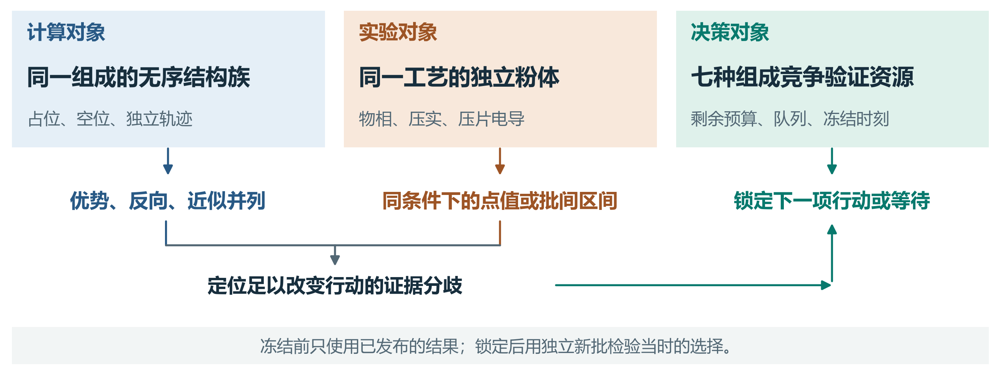
左侧研究对象是同一组成内部可能存在的结构及其输运，中部连接同条件下的粉体与压片，右侧才是决策单位。跨越第一条边界需要统计汇总。跨越第二条需要样品和工艺证据。跨越最后一条需要考虑可用名额、在制任务及证据发布时间。每条连接都对应一个可以失败的假设，失败时可定位应补哪一层的证据。
### 1.2 研究对象、比较单位与可证伪问题
首轮对象为名义组成从 x＝0 至 0.6、间隔 0.1 的七种配方。一个配方可有多个结构族，每族可有多个独立初态。一个粉体可以压成多片，每片可以重复装夹。统计单位应随问题改变。计算收敛以独立启动的轨迹和结构族为单位。工艺比较以独立粉体及其区组为单位。系统政策以同一资源条件下的完整研发任务为单位。把几十个锂离子的轨迹或同片多次扫描视作新增独立样本，都会低估误判风险[2–4]。
| 研究问题 | 同条件对照 | 什么结果会改变研究判断 |
| --- | --- | --- |
| 结构证据能使晶内排序更有依据吗？ | 固定结构池与计算预算，比较无结构观测的先验分布和经观测更新的分布 | 留出结构量无改善、方向随相容权重翻转时，保留不可辨识并改选观测 |
| 分歧需要改势，还是只需补结构或样品证据？ | 同一局域几何以独立 DFT 核对。同一粉体做有限分样，并另设独立合成 | 物相或接触已经解释行动差时维持现有势。原子参考复现相关偏差后才评估微调 |
| 有限前瞻能改善关键名额的使用吗？ | 候选、资源、费用上限和最终确认规则相同，在独立共同情景中重放政策 | 单步或固定规则若同样安全且更省资源，即保留简单规则。风险超限单独报告 |
表 1.1　研究问题、对照和判别条件
上述三个问题依次限定研究主张。一次计算可以验证算法是否守恒、输出是否随证据合理变化。一组公开结果可以判断方法能否解释文献现象。只有在新的独立粉体、轨迹或项目上先冻结方案、再取得证据，才足以检验预测和行动的前瞻性能。开题阶段据此区分公共实测、合成方法演示、情景化工作流评价与待实施的物理验证。

## 第2章　从文献确定比较对象与证据边界
### 2.1 七组成实测提供了怎样的试题
Mo 等的补充材料表 S1 提供七个宏观读数，正文图 1 将组成、XRD、阻抗谱和非单调电导曲线联系起来[1]。图 2.1同时保留两个不同制样组。看左图可知，最高点出现在内部组分。看冷热压子组则应沿同一配方比较。后者采用自制原料，三个配方热压后的点值均有所提高，组内排序在冷、热两种压实条件下保持一致。两组原料、压片与测量条件各有记录，分组处理才能分辨配方方向和加工影响。
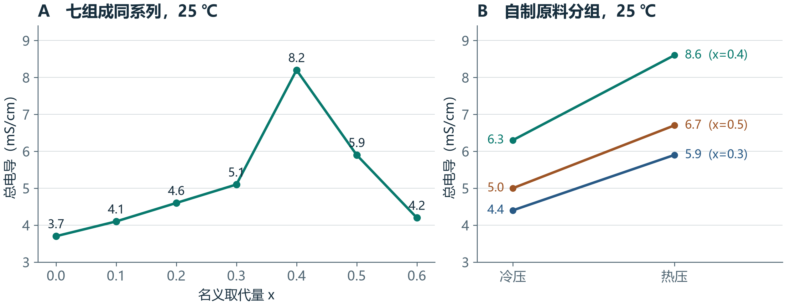
| 原始观测 | 它为本课题提供什么 | 使用限度 |
| --- | --- | --- |
| 补表 S1、正文图 1 的七组成室温总电导 | 同源非单调点值方向。检验算法会不会机械偏向更高含氯量 | 每种组成缺少可用的独立批次误差。七个点生成的 21 对方向共享样品 |
| 主文与补图 S6 的同原料冷热压对子 | 判断压实干预是否改变同组排序。为有限分样设计给出先例 | 组内未见逆序。不能从三个配方推断其他工艺都保持排序 |
| XRD 及补图 S2 的部分配方形貌 | 提出富氯端残余 LiCl、成相或颗粒接触等可检验解释 | 局部形貌与衍射峰不能直接给出所有结构族权重或势参数误差 |
表 2.1　公开基准包含的三类证据及其用途
七组中 x＝0.1 与 0.6 的点值仅相差 0.1 mS/cm，恰好说明按数值大小分出两名，与实际值得投入不同资源是两个问题。对这种近邻，以事先规定的最小可行动差复核方向。对峰值组，则要求方法能解释为何仍应验证 x＝0.5 的新样品。历史数据一旦参与设定结构假说、挑选帧或选择方法，即留在开发侧。真正的方向确认留待独立新批。
### 2.2 同一化学式内部，哪些结构差异值得追踪
Deiseroth 等对 Li₆PS₅X 系列的结构与迁移性研究确立了硫银锗矿的材料基础[5]。原位中子工作跟踪了形成阶段，针对 Li₅.₅PS₄.₅Cl₁.₅ 的前驱体混合研究进一步表明，相同的最终名义组成并不足以交代成相路径[6,7]。卤素取代、可控氯掺杂和锂缺位的实验分别改变了组成与局域环境[8–10]。因而，富氯端电导回落既可能与目标相实际化学计量有关，也可能反映含 LiCl 等其他相的比例变化。在给模型添加新的空位之前，需先核对物料、结构和目标相的相容性。
平均占位还丢失了相邻位点的排列。Minafra 等的温变中子精修使锂与阴离子位点约束有了实验依据。Hanghofer 等对 Cl、Br、I 同族材料的比较把取代无序与离子动力学联系起来[11,12]。Morgan 的受控有序、无序构型以及 Jeon 等对 Li 近邻的研究，将可检验现象具体落实到笼内重新分布和跨笼扩散[13,14]。Payne 等联合不同空间尺度的表征，发现同为 Li₆PS₅Cl 的冷压和放电等离子烧结样品，其占位和粒间接触均可变化[15]。因此即使 XRD 平均占位一致，也应保留几种短程排列。即使压实对照有效，也不能把变化全部归入接触。
外部体系适合提供候选机制，迁移到本材料时需说明条件。超富氯研究辨识出的锂位点可以加入候选库，x＝0.7 的电导则属于另一个组成和工艺[16]。富锂缺卤体系讨论了另一个补偿方向，Helm 等的大规模占位采样针对阴离子空位，二者都提示应先写清缺陷守恒，再谈构型丰度[17,18]。富溴材料的缓冷和淬冷导致不同占位，使我们有理由分开处理热历史。其具体温度和丰度不能直接移植[19]。对不同阴离子分布的模拟与实验、结构相干性研究及富氯 MTP 研究，可帮助确定应保留的局域描述符与比较结构，却不能补齐本组七个新批次的观测[20–22]。这种区分也体现在晶内与颗粒间的时空尺度。宽时间窗测量区分了体相和界面动力学，热压及致密化研究则关注压力、孔隙与接触敏感性[23–25]。Ou 等分别对体相与晶界扩散建模，又在多尺度工作中讨论微结构的有效输运[26,27]。它们支持保留晶界和连通性这条竞争解释。若当前目的只是决定要不要订一批样品，使这条解释接受一次有限分样检验，往往比先构建一个未经验证的宏观映射更可行。
### 2.3 原子势和主动学习的能力边界
从 Deep Potential 到 DeePMD-kit、等变网络及多任务预训练，研究者已能以可微势能表达产生力并开展较长时间的分子动力学[28–31]。DPA4 以等变卷积在精度和计算成本间寻求折中，专门面向硫化物固态电解质的 DPA-SSE 和已有 LPSC 缺陷应用则提供了领域对照[32–34]。本课题直接比较已发布势在相同几何及同一轨迹协议下的表现。已有模型构架和性能基准给出可用起点，配方内不同构型怎样按实验证据加权仍需另行定义。
参考计算的口径决定误差如何解释。PBEsol 与其他泛函对固体的参考并不相同，跨泛函迁移与通用势软化研究分别揭示了基准偏移和势能面局部形状风险[35–37]。若目标被试几何的局域力或迁移路径存在疑点，可以用成对的同口径参考和攀爬图像弹性带法检查能差[38]。Fu 等对力场的模拟评估显示，只报告全局力误差可能漏掉轨迹失稳，因此还需直接考察动力学表现[39]。因而，验收先看力和相对能，再看迁移相关环境及独立长轨迹，最终才比较配方排序。
并发学习、基于外推程度的主动选点、原子指纹选择和不确定性偏置轨迹，分别解决何处可能误差大、哪些参考构型彼此重复和怎样探索未覆盖区域的问题[40–44]。冻结表示的迁移学习则提供一种降低适配成本的对照[45]。这些工作没有把“会不会改变本周的确认选择”作为共同目标。本课题以多样性和模型分歧选择作为基线，检验在相同标签预算下，按结构可信度与排序敏感性进一步筛选局域环境能否减少错误行动。若固定势已经足够，增量应当接近零。
### 2.4 信息价值为什么必须与事件调度一起研究
多组分硫银锗矿的实验主动学习表明，配方选择可在循环中逐轮修订[46]。电池快充及电解液自动优化、薄膜与机器人化学实验展示了在约定平台内选择下一次实验的能力[47–50]。实验与计算实时互动和路径依赖性质的主动学习进一步说明，过去的操作及中途可用的读数会改变后续选择[51,52]。对硫化物，复用母粉、占用手套箱或送出唯一试片等动作还会改变后续可行性。因此，自动化的基本单位应从“下一组配方”扩展到“带样品与发布条件的一项行动”。
多信息源优化允许用带偏且低价的代理来选择昂贵测量[53,54]，级联与多阶段贝叶斯优化处理有先后依赖的实验，未知费用下的有限前瞻则把剩余预算写入决策[55–57]。异步和多保真优化允许在已有工作运行时继续派发[58,59]，多工位调度研究给出了在物理约束和科学依赖下处理资源竞争的办法[60,61]。本研究继承其成本、条件分支和异步执行思想。一个关键差异在于，结构观测只约束结构，原子参考解决势误差，压片 EIS 才直接观测宏观目标。三者不应先压成同一无偏标量再取最优。
最后，工作流模型的行为与政策效果需要分别验证。Sargent 区分模型实现核查和对实际系统的有效性验证。Glasserman 与 Yao、Nelson 与 Matejcik 讨论了共同随机数在配对比较中的适用方式[62–64]。本课题用这些原则隔离决策器与评价器。时间终点同时记录确认概率及限定观察窗内的平均等待，以免把“没有确认”从计算中删去而把慢策略误认为快[65]。由此可以提出三个递进的问题。结构证据能否约束有决策意义的晶内差异？这种差异能否接受新批宏观观测的检验？取得新证据时，原计划中的行动是否还来得及改变？
### 2.5 公开数据哪些现在就能用
原子计算首先需要核对每帧的元素、晶胞、能量、力和应力来源。OBELiX 的实验电导及相关结构适合寻找可追溯晶体起点，不能充当力标签[66,67]。Oxford 的 PBEsol 子集经逐帧核对有 28,100 帧，在这条化学线上仅包含 x＝−1、0、1。六个富氯中间组成都没有直接覆盖[68]。因此应优先将新增 DFT 用于核对 x＝0.4、0.5 等关键富氯环境，以判定从已有母体数据迁移时的风险。
| 数据源 | 已核实的内容 | 在本研究中的使用决定 |
| --- | --- | --- |
| Oxford、AIS SSE-VASP、SSE-ABACUS | 均取得归档。含原子参考的母体数据。AIS 的界面配比与七个目标组成有别 | 统一泛函、单位、应力号和类型表，先按来源与父轨迹分组，保留母体作为起步验证 |
| Bath、DaRUS | Bath 有界抽检完整读取一个母体 VASP 构型的能量、力、应力。DaRUS 一份包内不同训练集有重合构型 | 追查父轨迹与配位环境，消除跨组重复。仅取得元数据或示例的另一个归档待逐帧核验 |
| OBELiX、原始衍射与补充材料 | 可追溯的母体平均占位、宏观电导或结构文件，证据与样品条件绑定 | 在重建前向观测时提供条件先验，按 DOI 和样品分组 |
| 文献所述富氯 MTP、合作方标签 | 已有研究涉及 x＝0.5。本研究尚无可核对的对应帧级归档及合作方标签 | 取得许可及元数据后再计入训练预算。预训练重叠无法排除时单列 |
表 2.2　按实际取得程度划分的数据和可用范围
AIS 两类标签的计算设置及文件布局有别，须先在相同结构上检查跨程序的能量、力与应力约定[69–71]。完整读出一项 Bath 记录，只能证明该项标签可解析，全包仍需清洗。DaRUS 则出现另一类问题。即便已取得原始标签，同一构型在多份训练集内重复出现，也可能污染留出[72–74]。数据登记保留版本、许可证、文件哈希和核查范围。未取得富氯关键域的独立参考之前，本报告的概率算例一律作为方法演示。

数据边界厘清后，可以回到开题的起点。即使尚不知道批间误差分布，七个历史读数本身也允许估计每对配方的点值顺序能经受多大的相对扰动。
对七个公开点值还可以问一个不需要估计批间方差的问题：测量值要改变多少，两种配方才有可能交换顺序？令 $c$ 为报道电导，设各组成分别可在 $[c/f,cf]$ 内变化，$f\geq 1$。对于原先较高的 A 和较低的 B，当 $c_A/c_B>f^2$ 时，即使把 A 取到下限、B 取到上限，A 仍较高。临界因子 $\sqrt{c_A/c_B}$ 是两个区间首次相接的位置。这里的扰动仅探查确定性边界，未给任何偏移赋概率。

| 可乘除因子 | 仍必然保持方向的比较 / 对 | 区间可相交的比较 / 对 | 仍有可能排名第一的组成 x |
| --- | --- | --- | --- |
| 1.02 | 20 | 1 | 0.4 |
| 1.05 | 19 | 2 | 0.4 |
| 1.10 | 14 | 7 | 0.4 |
| 1.20 | 6 | 15 | 0.4, 0.5 |
表 2.3　公开电导点值对乘性扰动的排序敏感性
x＝0.6 和 0.1 的点值为 4.2 和 4.1 mS/cm，临界因子仅为 1.012。与此相比，x＝0.4 和 0.5 的临界因子为 1.179。如果目的是挑出一个独立确认对象，在 1.10 的假定扰动下，仍只有 x＝0.4 能居首；如果目的是排全七种配方，同一扰动已使七组方向失去保证。两项任务值得花的复测成本因而可能不同。若所有读数只受同一乘性标定偏移，它会在比值中抵消；表中检验的是组成之间可有不同偏移的情况。现场可用新批和标准件估计实际变异，再决定哪一档压力具有现实意义。

## 第3章　由结构证据建立配方内的输运分布
### 3.1 从名义组成到可以计算的结构族
一个 x 值规定元素计数，却不唯一确定原子坐标。在 Li₆₋ₓPS₅₋ₓCl₁₊ₓ 中，增加 Cl 的同时改变 S 数与 Li 数。取含 20 个 P 的周期胞可用整数精确表达七个名义组成。以 x＝0.4 为例，计量为 Li₁₁₂P₂₀S₉₂Cl₂₈，共 252 个原子。保持四面体框架的理想计数后，自由阴离子在不同位点的分布、相邻位点的相关性和锂空位附近环境仍可变化。即便两个候选胞的 4a 位平均 Cl 占位完全相同，其局部排列形成的迁移网络也可能不同[13–15]。图 3.1从一个计算胞出发，给出了向独立轨迹和实验粉体追踪所需的索引。
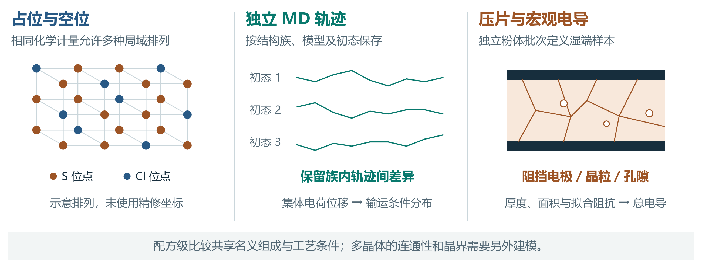
先按母体结构、占位档、空位环境以及短程相关定义结构族，再在族内选择几何候选。拟采用分层枚举或有记录的随机提议，利用对称等价和局域描述符合并近重复，同时保留少见而可能控制跨笼输运的环境。每个结构标明父结构、生成方法、抽样概率、热历史和等价计数。实际进入弛豫前，复查位点互斥、最近原子间距、晶胞形状与周期复制是否人为锁死迁移通道。整数胞解决的是计量问题，有限尺寸是否收敛另需更大晶胞对照。
同族不同初态的轨迹差异反映有限采样，可通过延长或增加独立轨迹检验。不同族的稳定输运差异则要求核对结构证据及权重。若把两类差异并入所有帧的方差，本应补表征的任务可能被误派为补算轨迹。
### 3.2 权重的物理对象与热历史先验
本课题将权重定义为给定配方、热历史和已知结构证据后，从相容的代表性局域结构中抽取到某一族的预测概率。若研究者希望把权重进一步解释成样品内不同结构域的体积分数，需要约定抽样尺度、实验响应的归一化方式，并有独立证据支持。另一种问题是“整块样品来自哪一个互斥的生成模型”。此时应分别求每个模型产生整套结构观测的似然，据贝叶斯规则更新模型概率。把互斥模型的两条衍射曲线混合到刚好符合一条实测曲线，无法证明样品恰由这两类空间域混合。下文的线性重加权只用于以系综矩为对象且已定义可加性的观测，合成数据中的概率也不当作实测域分数。
若目标族接近平衡，整胞同规模的相对自由能与简并度给出热先验。式（3.1）中，g 表示等价代表数，F 是每个代表状态的自由能，k 为玻尔兹曼常数，冻结温度决定制样后保留下来的结构分布。
$$
w_i^0=\frac{g_i\exp[-F_i/(k_{\mathrm{B}}T_f)]}{\sum_j g_j\exp[-F_j/(k_{\mathrm{B}}T_f)]}\tag{3.1}
$$
采用势模型的整胞相对能近似自由能时，应在同一组成、同一计量和同一参考口径内，先以独立 DFT 检查关键结构的相对次序，并对忽略的振动自由能做敏感性分析。若族自由能已计入族内构型熵，简并贡献只记一次。任意提议分布抽取的候选需要按目标与提议的概率比校正。已经从目标平衡分布抽取的去相关 MC 样本则用出现频率估计概率。有效冻结温度属于热历史模型，同室温 EIS 的测量温度承担不同物理作用[18,19]。外部样品能给这一步提供范围。例如从 OBELiX 一份 Li₆PS₅Cl 的 CIF 可核对该设置下 4a、4d 的 Cl 占位分别为 0.385 和 0.615。Payne 等的加工对照又显示另一组母体样品的占位会随制样方式变化[15,67]。这些数据说明可用实物约束筛除部分结构假说，却没有直接给出富氯配方的局域族权重。缺乏相应结构信息时，保留多个热历史与弱信息先验，并检查哪条排序会因此改变。
### 3.3 观测究竟能识别多少个权重
测得平均占位之后，是否已经足以判断 x＝0.5 几种快迁移的局域环境出现得更多？若几类构型的平均占位相同，它们之间任意调换权重都可能保留相同读数。增加另一项与短程排列敏感的观测，有时比提高第一项读数的小数位更能区分候选。图 3.2把测量值与模型预测放在同一观测尺度上，再把剩余分歧交给独立留出观测核验。
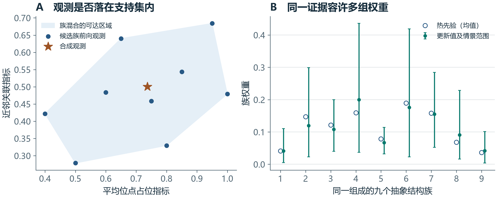
| 候选方法 | 可进入反演的观测或模型 | 本课题的选择条件 |
| --- | --- | --- |
| 直接结构精修 | 平均占位、相分数、晶格及其误差 | 用作支持集筛选及低阶矩约束，先查精修参数之间的相关性 |
| 枚举、重要性采样、MC 或簇展开 | 离散结构、能量模型与制样热历史 | 有可靠相对能时建立条件先验，核查对称去重、链间收敛与失去的结构族 |
| 贝叶斯或最大熵系综重加权 | 可预测的占位、局域信号及相应误差协方差 | 首选可检验的小规模模型。用留出观测与先验敏感性检查可辨识性 |
| 受原子势约束的反向蒙特卡洛 | 总散射及原子模型计算的完整散射响应 | 仅在具备散射原始数据、可靠相互作用与多初值复算条件时拓展 |
表 3.1　结构反演方法与观测条件
对允许线性叠加的观测，先在每个族上计算同口径前向量，再按权重加和，得到对实验量的预测。对衍射相干项、多相峰形或 NMR 信号归一化，须按相应测量过程计算前向响应。Bottaro 等在先验系综与实验约束间采用最大熵权衡。Cuillier 等用原子势约束散射反演，说明引入物理约束依然需要处理反演非唯一性[75,76]。本研究选用可复核的小模型起步。式（3.2）中，第一项衡量观测残差，协方差矩阵兼含实验与前向误差。第二项惩罚相对先验的偏离。优化约束为权重非负、总和为一。正则强度用独立结构量或预先设置的敏感性范围选择，历史电导方向留在比较端。
$$
J(w)=\frac{1}{2}[\hat{z}(w)-z]^{\mathsf T}\Sigma^{-1}[\hat{z}(w)-z]+\lambda\sum_i w_i\ln\frac{w_i}{w_i^0}\tag{3.2}
$$
以 x＝0.4 的合成算例为例，九个代表族受两个独立方向的代理观测约束，归一化后仍有六个线性方向不可辨识。未参与拟合的代理观测为 0.459，中心预测从 0.475 移至 0.464。留出量的改善验证了更新流程，九个权重仍有多组相容解。若各解都指向同一个确认配方，可暂缓进一步表征。只有相容解会导致不同选择时，才预约能区分它们的观测。
若样品观测落在候选的联合预测范围之外，先查漏相、实际成分和仪器模型，再扩充结构集合。各项观测分别处于常见区间，仍可能构成无法同时解释的组合。在支持集相容后，再按有效族数、权重集中度和留出残差，判断是否值得追加中子精修、定量固态 NMR 或总散射。
### 3.4 DPA4 在输运测量链上提供哪一步
DPA4 接收原子类型、坐标与周期晶胞，汇总原子贡献得到体系总能。力取总能对原子坐标的负梯度，virial 由胞形变导数按相应符号约定取得。输运须在固定势版本下推进轨迹、解开周期边界，并检查长时位移。式（3.3）给出三维各向同性的集体电荷估计。V、T 分别为体积和温度，求和取导电物种的电荷及其相对晶格的位移，平均跨时间起点与独立轨迹。固定骨架近似要求结构稳定并校正整体漂移[28,77]。
$$
\sigma_{\mathrm{coll}}=\frac{1}{6Vk_{\mathrm{B}}T}\lim_{\tau\to\infty}\frac{\mathrm{d}}{\mathrm{d}\tau}\left\langle\left|\sum_j q_j\Delta\boldsymbol{r}_j(\tau)\right|^2\right\rangle\tag{3.3}
$$
主读出优先采用可收敛的集体电荷输运，另报自扩散与 Nernst–Einstein 估计。相关跳跃使单粒子和集体量可能呈现不同趋势[77,78]。He 等和 McCluskey 等说明，拟合一条轨迹时，相邻滞后时间点无法替代独立重复[2,3]。Mo 的方向已用于开发，因此在运行真实轨迹、查看新轨迹排序与独立粉体结果前，须冻结主指标、拟合窗和收敛门槛。温度外推先查相稳定性与机制一致性。跨笼事件不足时记录采样期限及可辨识上限，延长轨迹、换初态或暂缓判定。能量景观近似只用于筛查[79]。计算前核对类型表、单位、赝势和应力号，以换序、旋转、微位移与胞形变检验响应，再由母体和富氯代表结构检验胞尺度。失败轨迹留下族内输运的不确定性，结构权重另由观测约束。

## 第4章　从分布比较到可行动的排序
### 4.1 随机变量、共同误差与实际并列
令 S 为抽取一个可信代表结构族时，其相对晶内输运量的自然对数。给定时刻 t 的公开信息 I，族内分布传播独立轨迹对族输运的估计误差。式（4.1）将各族分布按结构概率汇总，再对共享热历史或势版本的不确定性积分。样品若含多个空间域，其有效输运另受界面和连通方式控制，需建立并独立验证多尺度映射[26,27]。
$$
p_x(s\mid I_t)=\sum_{i=1}^{K_x}w_{x,i}\,p_i(s\mid x,I_t)\tag{4.1}
$$
累积分布将每个配方的低输运尾部和典型区间同时保留下来，见图 4.1。
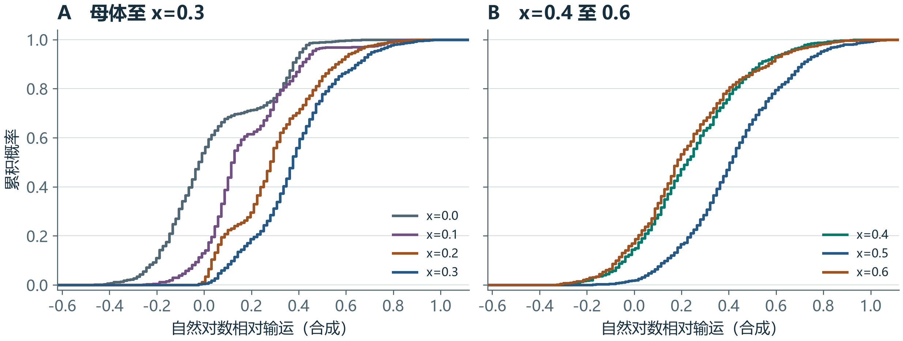
横轴为对数相对输运量，纵轴为落在该值以下的概率。比较相同横坐标可见两配方低输运尾部的风险，比较同一中间分位则可判断典型族的位置。淘汰标准若关注低输运尾部，仅比较均值可能选错配方。
令 D 为同一次联合抽样中 A 与 B 的对数输运差。给定最小可行动差 δ，式（4.2）同时给出 A 明显占优、B 明显占优及两者实际相近的概率。三者之和为一。若所有配方使用同一势、同一校准偏差或共同热历史参数，两者必须在同一外层情景下抽样。只有确有依据时才可将两个边际分布独立配对。
$$
p^+_{AB}=P(D>\delta\mid I_t),\quad p^-_{AB}=P(D<-\delta\mid I_t),\quad p^0_{AB}=P(|D|\leq\delta\mid I_t)\tag{4.2}
$$
### 4.2 为什么 x＝0.5 的优势倾向不足以淘汰 x＝0.4
每个组成设置九个抽象结构代表和合成轨迹代理。七种配方在同一情景共享冻结温度、势与观测扰动，再分别更新权重和抽取结构族。由此演示联合误差怎样影响决策。
这里将 x＝0.4 与 0.5 的历史宏观读数和合成晶内三态概率并排展示。读图 4.2时先定行动差。
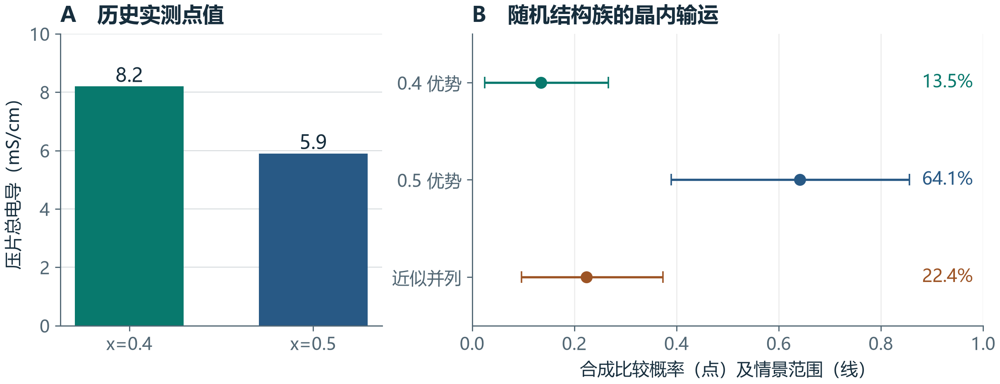
主算例将 10% 的相对输运差作为一道示范门槛，x＝0.4 明显领先、x＝0.5 明显领先、实际并列的平均概率分别约为 0.135、0.641、0.224。看似倾向后一组，但其领先概率在情景间的第 5 至第 95 百分位约为 0.390 至 0.855，跨过半数。仅用平均方向便淘汰 x＝0.4，会忽略一批仍与假设相容的世界。若把行动差提高到 20%，更多差异转入实际并列，结论进一步取决于工程需求。
保持两配方边际分布，仅打散共同扰动，x＝0.4 明显领先的概率便从约 0.135 变成 0.190。真实验证必须保存共同势与热历史的抽样索引，并用同版本、同工艺的多组成资料检查相关性。
### 4.3 七组成比较，怎样保留尚不能判定的关系
图 4.3每个非对角单元是行组成优于列组成的概率。
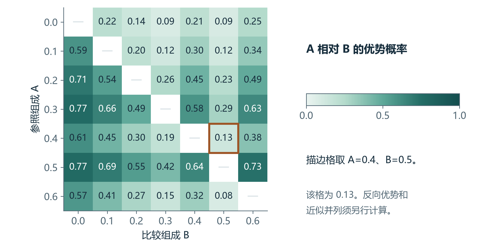
对称位置对应反向优势，两格概率之和距一的余量为实际并列。沿 x＝0.4 一行可识别接近行动门槛的对手。共同抽样还可统计进入前三的概率。两两优势可能不传递，算术均值、Spearman 或 Kendall 相关只作辅助描述。
图 4.4以历史点值较高的一方为参照，记录合成抽样对该方向的支持概率。
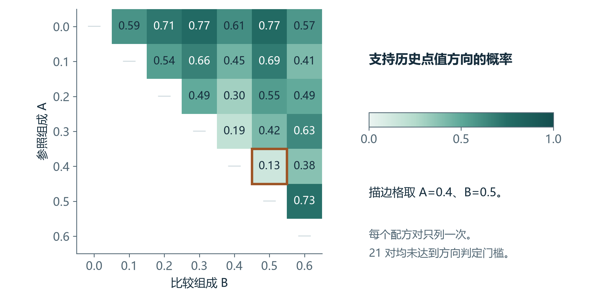
x＝0.4 与 0.5 的合成倾向与公开点值方向相反，但未达到足以淘汰任一方的门槛。推广到七种组成，当前合成设定下 21 对均不可可靠分向。这检验的是系统能否拒判。真实材料的判断须等待独立轨迹与新批结果。
回顾性评估保留每一对的方向、行动差与是否拒判，并可用 Brier 或对数损失描述与宏观历史方向的代理一致性。若只评价强方向而回避大量拒判，得分必须连同覆盖率公布。若将实际并列剔除后计算二元损失，还须明确二元概率如何归一或单列三类定义。这份开发表只有七个共享组成，重采样与区间估计应以配方或新粉体区组为单位。公开点值不能用来检验“预测概率为七成”的频率校准。
### 4.4 新批压片怎样回答另一个问题
宏观目标是按约定工艺制备的新粉体，在相同测量条件下形成的压片总电导。对每片保存厚度、电极面积、拟合电阻、谱文件与温度，由几何量和阻抗求得总电导。拟以对数总电导为响应，用区组及独立粉体的变异描述批间差异。同一粉体的多片和同片复测分别归入各自的重复层。小规模先导若不足以同时估计多套方差分量，就先报告区组内配对差、独立批数及可解释范围。
$$
q_{AB}=P(\mu_A-\mu_B>\delta_{\mathrm{exp}}\mid Y_{\mathrm{batch}})\tag{4.3}
$$
式（4.3）中，μ 为同 SOP 下独立新批的平均对数总电导，实验阈值按测量精度和工程需要预定。若比较未来两块压片而非配方平均效应，应继续抽取批间、片间差异。只有冻结方向、阈值和规则后取得的新批，才能支持独立验收。宏观达标概率应来自实验模型或经验证的跨尺度映射。

## 第5章　分歧出现后，哪一层证据值得补
### 5.1 让一项观测区分两种会导致不同行动的解释
若 x＝0.5 晶内输运向好、实际压片表现偏低，可以提出至少两个会导致不同支出的解释。一是样品中的富氯目标相不足或局部接触不良，再算理想晶体仍回答不了压片为何偏低。二是模型对一个常见跨笼环境的力和相对能差有系统偏差，即便新批样品正常，后续候选的计算排序仍会受影响。二者也可并存。最能帮助决定的第一项证据，应区分足以改变行动的解释，并在名额冻结前返回。图 5.1按这一原则将证据引向相应的更新对象。
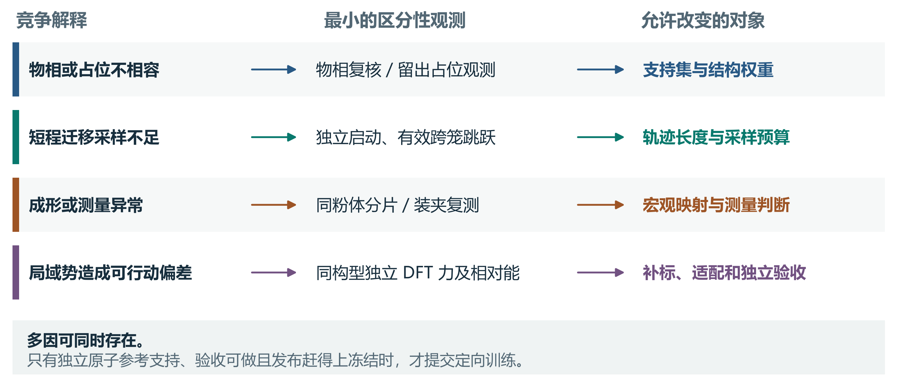
| 观察到的现象 | 可以选择的判别行动 | 哪个结果会改动下一步 |
| --- | --- | --- |
| 富氯样品出现额外衍射峰或计量偏差 | 复核相鉴定与成分，在同批材料上查目标相 | 若原支持集缺相，改候选与前向量。同相仍有歧义时再评估局域表征 |
| XRD 可接受、局域排列仍有两解 | 优先选择能区分两解的中子、定量 NMR 或总散射，先核对实际可得性 | 相容权重导致不同决策才追加该项。无法区分时保留两解 |
| 一片低电导，或重装后的拟合不稳 | 谱拟合复核、同粉小范围分样、密度与几何复测 | 技术重复用于检查装夹。跨批目标需另制新粉。结果先更新样品映射 |
| 晶内信号取决于少数跳跃或小盒几何 | 增加独立初态、延长轨迹或作较大尺寸对照 | 差异在收敛后消失，解除势误差指控。仍持续时选择有辨识力的 DFT |
| 同一关键环境在独立原子参考中持续偏离 | 成对选择迁移路径、局域扰动及相近正常环境，比较力和相对能 | 同误差足以改变排序、可按时验收与重算时，才触发定向补标 |
表 5.1　从异常到区分性证据及行动改变
若相容权重怎样变化都不会改变复验名单，预约一个月后才返回的中子机时对本轮无增益。若两种同样符合 XRD 的结构会导致不同提名，且局域表征赶得上冻结，则先补结构证据。两种原因暂时无法区分时，记录最便宜的可撤回行动和其截止时刻。
### 5.2 从诊断性干预到等预算的原子补标
工艺在本研究中承担隔离干扰的作用。标准合成沿现场批准的 SOP 固定。同粉分样、有限压实和重新装夹只在前提允许时用于诊断。Mo 的冷热压三配方保持顺序，可说明该组压实带来共同提升，却不能证明今后低电导都来自颗粒接触[1]。当同一批补充结构或样品证据能解释分歧时，把该案例登记为一次有依据的“保持固定势”。这样才能把避免无效训练纳入评价。
当两方配方的决策仍依赖同一个可疑局域环境时，再沿原子线取证。先依据相容族和对决策边界的贡献缩小范围，从可能决定跨笼跳跃的局域几何选取同口径诊断 DFT。对于疑似异常力，用相同坐标与原子顺序作比较。怀疑能垒时，比对同一迁移路径的相对能差。诊断集回答该偏差是否存在。另从训练池选择代表性和稀有环境补标，最终用封存的家族、轨迹或整组组成评价。三类参考各有标识和费用。一次用于诊断或选超参的构型不可再以换名方式计入最终盲测。
| 原子策略 | 同一候选池中如何分配补标 | 主要检验问题 |
| --- | --- | --- |
| G0 固定已发布势 | 不新训。冻结 DPA4 Plus、Neo，并设独立领域势 DPA-SSE 对照 | 当前势在同一几何、轨迹与评价条件下是否已经足够 |
| G1 随机补标 | 在允许池按预登记随机种子抽取 | 仅靠增加等量标注能改善多少 |
| G2 分歧与多样性 | 用多模型或委员会分歧和局域覆盖选取代表 | 常规主动学习已能获取多少增量 |
| G3 决策相关补标 | 在 G2 可比预算内再考虑族可信度、独立局域误差及排序敏感性 | 能否减少错误归因、发生在关键候选上的误判或无益训练 |
表 5.2　区分原子势更新收益的等预算对照
G1 至 G3 共用初始化、潜在标签池、参考口径、DFT 与训练预算和最终盲测。先固定评价结构与权重，比较改变势参数带来的差异，再固定势版本，只改变权重，最后评估两者共同更新的端到端结果。这三步把改进来自表征、来自势、还是两者互相作用分开。标签有效性优先依据留出局域环境误差和下游决策的变化判定。某条标签被算法主动选中，只说明它获得了预算，不能单独充当有效性的证据。
### 5.3 可发布的模型与可回退的决定
本研究采用版本化的 DPA4 接口。所核 DeePMD-kit v3.2.0 与 OMat24 的 Plus/Neo 权重采用各自条款，研究与后续产业用途需分别核对。推断权重、可训练检查点以及 DPA-SSE 领域势按来源分别登记[33,80,81]。若触发训练，可在实际支持的 PyTorch 检查点上先做单步微调预检。是否冻结部分表示、使用低秩适配或全量微调，由参数掩码、训练预算、源域保持与独立验收决定。通用工作流可复用任务编排和数据传递接口，已有自动适配封装仍须逐版本检验其对 DPA4 的支持[82,83]。能量、力及经单位与符号验证的 virial 构成原子监督。总能误差按可比体系和有效原子数处理，力误差按受测原子与有效分量归一化。各项权重和单位在训练前锁定。含有异参考的绝对能先做桥接或分域处理。对 Li 及瓶颈局域环境单列误差尾部、成对迁移能差、源域回归与独立轨迹稳定性。验证未通过、改善对当前选择无影响，或重算结果将在冻结后才可见，均可保留原版。每个已发布结果携带它使用的模型版本和生效时间。未来版本不得无痕覆盖过去作决定时所见的证据。

## 第6章　将信息价值放进真实的时间顺序
### 6.1 用一个不可逆名额定义决策损失
系统模型从七种组成完成一轮初筛、各自已经取得同版势的代理读数时开始。接下来只有一个可留给独立新批的确认名额。冻结时从已有合格筛查证据的候选中提名一个，风险条件不足时允许留空。评价一直跟到独立新批结果通过审核。在这段流程里，每做一项诊断都可能改变候选、证据或等待时间，也可能完全不改变最后的提名。这个设定使“补算是否值得”有了直接的判据。
用 I 表示当时已经公开的初筛和原子计算读数、样品余量、共享资源的在制任务、候选各自的局域与样品状态信念，以及仍可用的预算和冻结时间。潜在真实状态 θ 留在评价环境中。对当时可行的决定集合，式（6.1）给出最小期望决策损失。可行决定包括不提名。错误提名与错过达标样品对应不同后果。实际现场需先约定宏观下界和可容许风险，情景实现仅用事先登记的概率门槛表示相对损失。
$$
R(I)=\min_{d\in\mathcal D(I)}\mathrm{E}[L(d,\theta)\mid I]\tag{6.1}
$$
假定一项行动能及时提供读数 y，且决策仍可更改，执行该项观测带来的单步样本信息期望价值由式（6.2）定义[84]。完全信息价值则令决策者事先知道同一模型的全部潜在状态，在相同决策与损失下给出理想上界。如果证据要等到名额冻结后才发布，下面的静态差值就不能直接算作项目收益。必须把任务放回服务与审核日历，与“现在等待”“先做另一项”“同时发起”进行比较。费用和机器时长分别进入可行域与事件日历，资源不以随意设定的汇率重复折算成风险。
$$
\mathrm{EVSI}(a\mid I)=R(I)-\mathrm{E}_{y\mid I,a}[R(I,y)]\tag{6.2}
$$
### 6.2 状态如何跨组成传递，怎样保证决策看不到未来
若给每个配方各自独立地算一套“有无势误差”的分数，x＝0.5 的诊断 DFT 对其他配方永远没有任何价值，这会妨碍对模型共享性的检验。新仿真引入一个全队列共享的势风险状态，在其条件下为各配方生成结构水平、接触状态与局域势偏差。结构与接触倾向共同决定该配方在标准工艺下的长期目标状态。初筛粉体 B1 据此抽取一次实际批次状态，同粉分样共享这个状态。冻结后的新制粉体 B2 从同一配方条件重新抽取物理达标状态，再独立抽取检测读数。势偏差则改变模拟读数的可信度，且允许与接触问题并存。这里的二元读数是工程仿真观测模型，物理输运分布和真实批间波动仍由前述原子和湿端方案测量。
一个配方的独立 DFT 若支持局域势误差，会提高该候选的局域偏差信念，也可能通过共享状态改变其他候选旧势读数的可信度。更新只使用已发布的报告。现场若缺少跨族相关性，应减弱或取消跨组成的统计耦合。共享与无共享政策在同一队列配对比较，可检验这一假设的行动价值。
图 6.1把样品消耗、仪器占用和证据发布画成不同的事件。
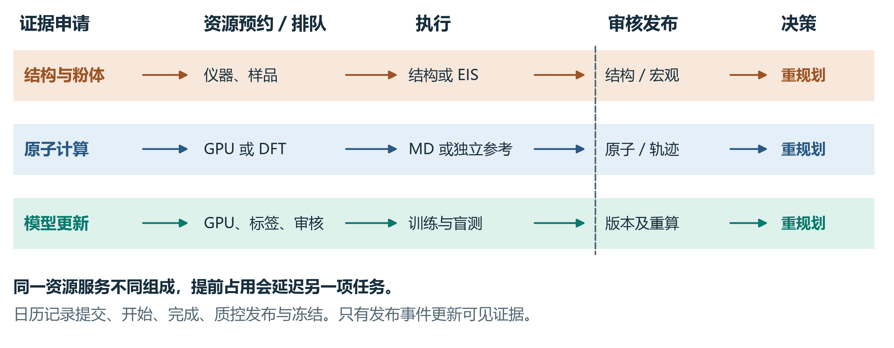
项目允许的追加行动包括重测压片、结构或接触检查、独立 MD、诊断 DFT，以及有证据才开放的模型适配与重算。每项行动经历占用工位和审核，只有最后发布的结果才可更新信念。若当前最有价值的信息已经在审核，而同工位的第二份检验会堵住随后更重要的样品，等待报告可以保留调度余地。冻结后尚未开始的任务可取消。已开始的任务按操作规则占用资源、保留费用，迟到的证据不追记为本轮提名的依据。
图 6.2用两个信息边界划分规划与评价。
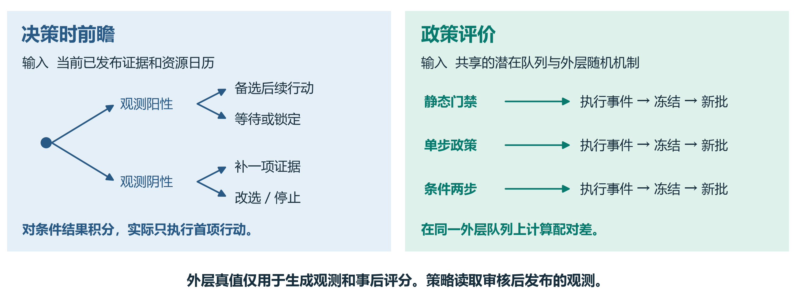
内层从当前公开队列推算可用工位、后续工序和条件观测分支，比较可行首步。外层按组成、任务和机制固定随机流，使不同政策重演同一潜在候选与工作负荷。同一任务的潜在观测或工时不随调用次序改变。内层只能用可见状态和近似服务日历，不可读取外层真值。
### 6.3 从单步价值到有限条件前瞻
固定门禁为若干初筛靠前候选依次追加预定检查，是可复核的起点。成本和资源感知的单步政策则枚举当前可行行动，以各种可能报告的概率计算风险下降，保留费用、余样及冻结时间约束。如果同一轮只有两个候选，且不论补哪项证据都仍会锁定同一配方，单步价值可以很小。反过来，一次 DFT 阳性可能开放新的适配行动，单步政策容易低估“做完第一项才能启动第二项”的价值。
有限前瞻在可行的首步中保留一小批候选，并对不同结果有条件地选择第二项或停止。队列中有待发报告时，也比较立即并行与待结果后选择分支。取当前首步执行，下一次发布后重新规划。它是有深度、搜索宽度和日历精度限制的近似策略。若前瞻偏爱等待但实际审核长尾很重，或某首步因搜索裁剪未进入考虑范围，单步与固定门禁都可能赢。这些反例是政策比较要回答的问题。将行动增益一律换成“方差下降除以费用”会忽略风险边界、报告时点及诊断能解锁的行动，这里保留条件分支和停止作为比较对象。
| 情景里允许的决定 | 依赖的公开信息 | 资源或终点约束 |
| --- | --- | --- |
| 追加湿端证据或并行原子计算 | 初筛已发布、仍有可用粉体或算位，后续行动可变 | 湿端分样消耗、服务及审核均占用日历 |
| 定向适配、沿用固定势或等待 | 只有已发布且相关的原子偏差证据能开放适配路径 | 需完成标签、训练、独立验收、发布和重算。失败回退 |
| 提名一个配方或留空 | 合格筛查证据与当时后验达到预设条件 | 冻结时一个名额，随后另制新批并审核 |
| 评价各政策的得失 | 同一外层真值与稳定随机机制，完整跟踪独立批 | 真达标确认、错放、错过和情景成本各自报告 |
表 6.1　资源仿真的决定、信息和硬约束
### 6.4 现场日志怎样把情景模型变成可验证的产线模型
宜宾新能源新材料数智创新中心的公开材料涉及深势科技与当地共建。深势科技（宜宾）有限公司曾公开报告已建设电解液及固态电解质干湿闭环智慧实验室[85]。可以据此询问与本课题相关的实际工位，却不能由整个平台的能力推定某台设备、惰性转运链、外送表征或计算配额今天能为本项目使用。文献中球磨 5 h、500 ℃ 热处理 8 h 描述特定论文的制样条件，尚需另计装料、切换、升降温、清洁及人工审核[1]。
| 首次走访需取得的记录 | 谁或什么提供证据 | 怎样进入后续模型 |
| --- | --- | --- |
| 一份样品从收样至审核发布的完整时间链 | 样品台账、实际工位、质控责任人 | 按提交、等待、服务、重试、审核分解时间，识别串行环节 |
| 同一时段各项目占用与班次、炉位及拼批规则 | 设备日历、维护记录、当班人员 | 由到达、容量与优先级生成排队，避免再叠加独立等待分布 |
| 独立新批、同粉分样、密封转运、外送权限 | 现场 SOP、粉体余量、预约方 | 筛除物理不可执行的行动，登记不可逆时点与可取消成本 |
| 算力队列、标签费用、模型发布与撤回记录 | 集群调度器、参考计算与模型管理人 | 区分直接工时和共享等待，确定新版何时能影响仍可更改的预测 |
表 6.2　宜宾现场先导的最小证据与模型用途
参数按可核实程度分级。宜宾直接证据为 A，相关合作平台为 B，同类仪器或文献为 C，工程估计和敏感性假设分别为 D、E。采集任务、母粉、工位、人员与模型版本时，至少覆盖投入至审核的完整周期。现有费用、工时和误判率仍属情景假设。后续用较早时段校准，以较晚时段检验拥堵、发布延迟及项目确认率。

## 第7章　单次确认机会的政策试验
### 7.1 统一比较的终点、费用与误差
系统评价先锁定同一诊断预算上限、一个后续新批名额和相同观察窗。主终点为截至观察窗，被提名配方的长期目标达标、新粉体 B2 实际达标且其独立测量报告阳性的项目比例。所有政策都使用同一筛查和最终审核接口。提名正确但未得到阳性确认、放弃名额和错提名分别记账。资源费用取已实际开始的各项操作之和，并区分追加诊断预算及后续确认成本。这样，策略即便很少提名而显得安全，其错失的可达标机会仍会出现。
$$
\mathrm{RMST}(H)=\mathrm{E}[\min(T_{\mathrm{conf}},H)]\tag{7.1}
$$
如需比较等待时间，式（7.1）中 H 是观察截止时刻，首次独立阳性报告的时间记为 T。未得到阳性报告的项目以 H 计入。这是可从报告时间读取的终点。外层真值另用于识别一次阳性报告是真达标还是误放，实际现场没有全知真值，需以事前约定的盲测和独立复核作为替代。对二元成功率、风险或费用比较，同一外层情景中先计算政策差，再汇总配对差与区间。区间反映模拟重复误差。参数假设、先验与产线资源误差须通过另行改变场景评估[62–65]。
### 7.2 同一确认名额下，补证带来了什么

冻结时有两道门。第一道门看初筛粉体是否至少有一次合格的压片读数，第二道门看现有证据对配方长期达标的支持是否已超过预设门槛。通过两道门的候选共同竞争一个新批名额。入组时每个组成已经有同一制度下的一份合成初筛 EIS 与旧势 MD 报告，工时和费用从此刻开始记账。追加诊断最多占用 2100 情景元，另预留 770 情景元给正式确认。每个重复包含全部七种组成。

基准设定将制批波动与仪器误判分别计入。长期目标达标的配方也只有 94% 的新制粉体实际达标；长期目标未达标的配方仍有 10% 的批次可能过线。新粉体实际达标时，仪器给出阳性报告的情景概率为 94%。因此，一次有利的初筛读数即使足以占用名额，仍可能在下一次制批或独立判读时落空。这些数值用于设定可重复的挑战，待现场独立批次估计。

|冻结前的政策|新批真实达标并阳性确认|错误占用唯一名额|平均追加及确认费用|
|---|---:|---:|---:|
|仅用入组证据|80.37%|8.89%|768 情景元|
|前三项固定补证|84.38%|3.91%|1873 情景元|
|资源感知单步|85.64%|2.44%|1659 情景元|
|条件两步|86.13%|1.66%|1437 情景元|
表 7.1　统一门槛下四种政策的队列结果。各行使用同一组 1024 个外层情景。错误占用以被提名配方的长期目标不达标定义，分母为全部队列。所有费用排除入组前的共同初筛成本。

与单步相比，两步每个队列平均少花 221.24 情景元，配对差的 95% 蒙特卡洛区间为少花 198.02 至 244.46 情景元。对应的真实确认率差只有 +0.49 个百分点，区间跨零（−0.91 至 +1.88）。两步会对“先等现在这份报告，得到阳性后做什么，阴性后做什么”估值；在这个名额稀缺、工序尚有余量的设定中，它经常保留第二次下单的机会。费用差可以辨认，确认率提高尚无法从这组重复中辨认。图 7.1给出配对比较，横轴上的零表示在相同七个候选上，两种政策没有平均差异。

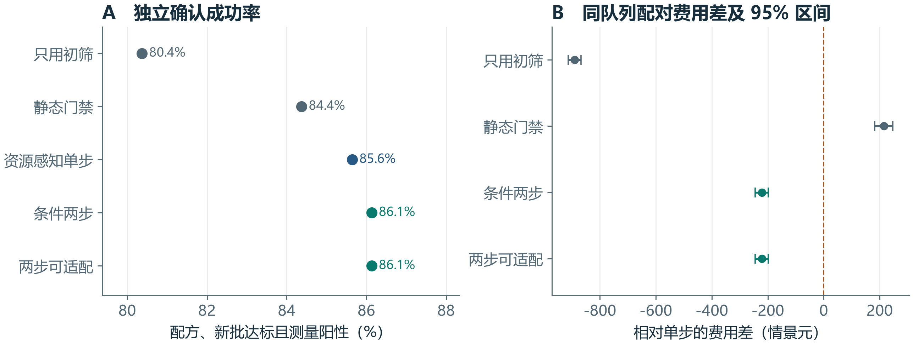

### 7.3 一份迟到前的阴性报告怎样改变提名

图 7.2回放种子 874039。开始时，结构观测先后把组成 0.2、0.1 推到前面；0.1 的同粉分样报阴，又让 0.2 领先。后到的结构证据使 0.3 成为竞争者。此时最值得改变的是给谁安排分样，正式名额仍可等待。

决定性证据是 31.56 h 发布的 0.3 分样阴性，其长期达标后验降到 0.677。32 h 冻结时，两步政策提名了仍有初筛阳性、后验约 0.930 的 0.2；独立新批在 47.75 h 报阳。同一情景下，单步选了 0.4，未得到真实阳性确认。另一共同情景（种子 874061）恰好相反：单步选择 0.0 并成功，两步选择 0.2 未成功。这些合成回放查明哪份证据改变行动，政策效果仍由全部配对重复评价。

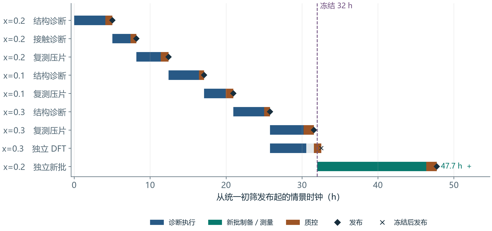

### 7.4 何时值得训练，结论对假设有多敏感

基准中的 1024 个队列都没有请求适配，固定势和允许适配两组的主终点相同。两步比单步更少花钱，却在无局域势偏差的候选上多申请了约 0.026 次 DFT／队列。这类阴性结果可以排除解释，也实际占用算力。诊断支出与训练收益要分别评价；后者仍需独立原子参考与真实轨迹。

另用 192 个开发队列选择门槛，在错误提名比例不超过 6.5% 的约束下最大化真实确认率。单步与两步都选中 0.58。冻结门槛后，在 512 个独立队列中，实际错误提名率分别为 2.93% 和 2.54%，真实确认率分别为 86.33% 和 86.91%。两种政策面对同一风险上限，实际达到的风险仍有差别。

提前冻结或加重审核拥堵，会使等待的报告失去行动价值。联合改变七类参数，在 24 个设计点上各比较 96 个配对队列，允许适配的两步政策相对单步的确认率差从 −5.21 至 +5.21 个百分点。这个跨度描述假设改变后的结果。现场应优先采集批间波动、同粉复测相关性、审核耗时与冻结时刻，用它们重估何时该等、何时该并行。

## 第8章　独立验证、实施进度与结论
### 8.1 用独立粉体核实宏观方向
前述单名额模型刻意制造一个资源瓶颈，以便判断政策是否改善第一次不可逆选择。为估计两个组成在标准 SOP 下的宏观方向，待执行的湿实验需为两者均取得独立粉体。图 8.1给出两者的关系。首轮计划两个制备区组，每个区组包含七组成，区组内随机顺序，共 14 个独立粉体。保留原料批次、设备、气氛、粉体谱系、目标相与压片几何。追加的同粉分样挂在同一个父粉体之下，单列为诊断。
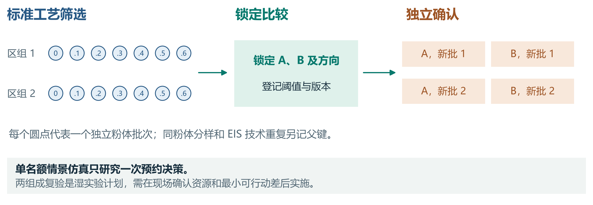
筛查后冻结 A/B 组成、方向、宏观下界、行动差和谱拟合规则。第二阶段在两个新制备区组分别制备 A、B，共四份独立粉体，审核后按盲码解盲。文中的 x＝0.4、0.5 不预定为最终对照。两区组先导用于估计批间不确定性，精度不足时按预登记规则追加独立区组。
### 8.2 现场、计算和政策三条验证线如何汇合
现场侧核实硫化物 SOP、样品转移与审核日志，计算侧冻结参考协议、代表结构及留出，政策侧回放资源占用和证据发布。三条线在同一条记录上汇合，追踪何时有了哪份新证据，哪项假设因此改变，哪一项未冻结的行动随之调整。
| 阶段及拟用时段 | 形成的可检验产物 | 进入下一阶段或改道的依据 |
| --- | --- | --- |
| 第 1–2 周，边界与现场核实 | 一项完整工序回放、SOP 与资源权限清单、三类盲测组登记 | 独立新批或惰性转运未获确认时，继续离线审计，湿端保持待执行 |
| 第 3–6 周，结构与固定势先导 | 母体及关键富氯候选、留出结构量、同构型 DFT 探针与轨迹日志 | 若支持集无法复现实测先扩充结构。若跳跃不足先补 MD |
| 第 7–10 周，七组成筛查与排序 | 独立区组的粉体谱系、筛查数据、按冻结规则发布的概率矩阵 | 对确认决策敏感的歧义按信息价值选择取证。充足时锁定 A/B |
| 第 11–14 周，冻结确认与模型对照 | 未见粉体及原子留出、固定与可调势对照、完整时间和费用记录 | 训练验收失败沿用旧势。确认精度不足则报告未决或追加独立区组 |
| 第 15–16 周，留出项目检验与总结 | 以较晚时段检验事件模型，复算等约束政策差并登记失败案例 | 明确可复用的资源与证据接口，以及必须随材料重建的物理部分 |
表 8.1　以可交付证据和退出条件安排的研究进度
表 8.1 的周次自合作方确认资源后起算。高级表征超期，按已发布证据保留排序区间。富氯标签不足，优先补影响提名的局域参考。若风险和召回约束无法同时满足，则在留出项目中标明不可行范围。
### 8.3 结论与尚待证实的问题
拟检验的贡献分别对应三种独立证据。以未见结构量和轨迹检验给定结构条件下的晶内概率，以独立 DFT 与粉体对照区分势误差和样品问题，以留出项目比较等待、并行或补证的实际后果。
Mo 的七个压片读数给出了统一条件下的非单调点值顺序，缺失的独立批次误差限制了可宣称的精度。合成排序保留了方向倾向和拒判的差别。资源试验进一步显示，在基准情景下，两步前瞻比单步平均少用约 221 情景元，但确认成功率差异尚不能与配对重复误差区分。允许适配的基准组未触发一次微调，因此现有数据无从估计训练本身的增益。仍需以真实数据回答的是，与 AISI 可用模型及现场 SOP 匹配的构型分布能否识别、两个重点组成的真实晶内和宏观方向是否一致、定向微调会不会在冻结前带来足够的净收益。试点每次决策均保存样品或构型、当时可见的状态，以及下一份什么证据会改变行动。正式转入现场前所需的确认项及可复现入口见附录 A。

## 参考文献
[1] MO C, YANG Y, WANG Z, et al. Regulating the anion disorder and synthesizing the low-cost and high-performance Li6−xPS5−xCl1+x solid electrolytes[J]. Journal of Alloys and Compounds, 2024, 971: 172727. https://doi.org/10.1016/j.jallcom.2023.172727
[2] HE X, ZHU Y, EPSTEIN A, et al. Statistical variances of diffusional properties from ab initio molecular dynamics simulations [J]. npj Computational Materials, 2018, 4(1): 18. https://doi.org/10.1038/s41524-018-0074-y
[3] MCCLUSKEY A R, COLES S W, MORGAN B J. Accurate Estimation of Diffusion Coefficients and their Uncertainties from Computer Simulation [J]. Journal of Chemical Theory and Computation, 2025, 21(1): 79-87. https://doi.org/10.1021/acs.jctc.4c01249
[4] LAZIC S E, CLARKE-WILLIAMS C J, MUNAFÒ M R. What exactly is ‘N’ in cell culture and animal experiments? [J]. PLOS Biology, 2018, 16(4): e2005282. https://doi.org/10.1371/journal.pbio.2005282
[5] DEISEROTH HJ, KONG ST, ECKERT H, et al. Li6PS5X: A Class of Crystalline Li‐Rich Solids With an Unusually High Li+ Mobility [J]. Angewandte Chemie International Edition, 2008, 47(4): 755–758. https://doi.org/10.1002/anie.200703900
[6] RAO R P, SHARMA N, PETERSON VK, et al. Formation and conductivity studies of lithium argyrodite solid electrolytes using in-situ neutron diffraction [J]. Solid State Ionics, 2013, 230: 72–76. https://doi.org/10.1016/j.ssi.2012.09.014
[7] LANGE M A, FAKA V, KRAFT M A, et al. Insights into Li5.5PS4.5Cl1.5 Formation Based on Precursor Mixing: In Situ Monitoring via Neutron Powder Diffraction [J]. Inorganic Chemistry, 2026, 65(35): 20522–20533. https://doi.org/10.1021/acs.inorgchem.6c03060
[8] ADELI P, BAZAK J D, PARK K H, et al. Boosting Solid‐State Diffusivity and Conductivity in Lithium Superionic Argyrodites by Halide Substitution [J]. Angewandte Chemie International Edition, 2019, 58(26): 8681–8686. https://doi.org/10.1002/anie.201814222
[9] YU C, LI Y, WILLANS M, et al. Superionic conductivity in lithium argyrodite solid-state electrolyte by controlled Cl-doping [J]. Nano Energy, 2020, 69: 104396. https://doi.org/10.1016/j.nanoen.2019.104396
[10] FENG X, CHIEN PH, WANG Y, et al. Enhanced ion conduction by enforcing structural disorder in Li-deficient argyrodites Li6−xPS5−xCl1+x [J]. Energy Storage Materials, 2020, 30: 67–73. https://doi.org/10.1016/j.ensm.2020.04.042
[11] MINAFRA N, KRAFT M A, BERNGES T, et al. Local Charge Inhomogeneity and Lithium Distribution in the Superionic Argyrodites Li6PS5X (X = Cl, Br, I) [J]. Inorganic Chemistry, 2020, 59(15): 11009–11019. https://doi.org/10.1021/acs.inorgchem.0c01504
[12] HANGHOFER I, BRINEK M, EISBACHER S L, et al. Substitutional disorder: structure and ion dynamics of the argyrodites Li6PS5Cl, Li6PS5Br and Li6PS5I [J]. Physical Chemistry Chemical Physics, 2019, 21(16): 8489–8507. https://doi.org/10.1039/C9CP00664H
[13] MORGAN B J. Mechanistic Origin of Superionic Lithium Diffusion in Anion-Disordered Li6PS5X Argyrodites [J]. Chemistry of Materials, 2021, 33(6): 2004–2018. https://doi.org/10.1021/acs.chemmater.0c03738
[14] JEON T, CHA G H, JUNG S C. Understanding the anion disorder governing lithium distribution and diffusion in an argyrodite Li6PS5Cl solid electrolyte [J]. Journal of Materials Chemistry A, 2024, 12(2): 993–1002. https://doi.org/10.1039/D3TA06069A
[15] PAYNE B T, JUELSHOLT M, PÉREZ-OSORIO M A, et al. How multi-length scale disorder shapes ion transport in lithium argyrodites [J]. Energy & Environmental Science, 2025, 18(19): 8876–8888. https://doi.org/10.1039/D5EE01612F
[16] WANG Y, BAZAK J D, ZHOU L, et al. Liquid-like solid-state diffusion of lithium ions in super-halide-rich argyrodite [J]. Cell Reports Physical Science, 2024, 5(12): 102314. https://doi.org/10.1016/j.xcrp.2024.102314
[17] ZHOU L, ZHANG Q, NAZAR L F. Li-Rich and Halide-Deficient Argyrodite Fast Ion Conductors [J]. Chemistry of Materials, 2022, 34(21): 9634–9643. https://doi.org/10.1021/acs.chemmater.2c02343
[18] HELM B, SARAVANAN R S, LANGE M A, et al. Exploring the Possibility of Extrinsic Anion Vacancies in Li6PS5Cl [J]. ACS Applied Energy Materials, 2026, 9(18): 12499–12509. https://doi.org/10.1021/acsaem.6c02127
[19] GAUTAM A, AL-KUTUBI H, FAMPRIKIS T, et al. Exploring the Relationship Between Halide Substitution, Structural Disorder, and Lithium Distribution in Lithium Argyrodites (Li6−xPS5−xBr1+x) [J]. Chemistry of Materials, 2023, 35(19): 8081–8091. https://doi.org/10.1021/acs.chemmater.3c01525
[20] LAVRINENKO A K, FAMPRIKIS T, QUIRK J A, et al. Optimizing ionic transport in argyrodites: a unified view on the role of sulfur/halide distribution and local environments[J]. Journal of Materials Chemistry A, 2024, 12(39): 26596–26611. https://doi.org/10.1039/D4TA04628E
[21] BÖGER T, STROTMANN K, FAKA V, et al. Impact of structural coherence and disorder on the ionic transport and lattice dynamics in Li+-conducting argyrodites [J]. Journal of Materials Chemistry A, 2025, 13(45): 39211–39228. https://doi.org/10.1039/D5TA07185B
[22] JANG M, PARK K, JUNG H G, et al. Unraveling Li-ion transport mechanisms in high-entropy anion-disordered argyrodites via machine-learned interatomic potentials[J]. Journal of Materials Chemistry A, 2025, 13(22): 16547–16555. https://doi.org/10.1039/D5TA02205C
[23] YU C, GANAPATHY S, DE KLERK N J J, et al. Unravelling Li-Ion Transport from Picoseconds to Seconds: Bulk versus Interfaces in an Argyrodite Li6PS5Cl–Li2S All-Solid-State Li-Ion Battery [J]. Journal of the American Chemical Society, 2016, 138(35): 11192–11201. https://doi.org/10.1021/jacs.6b05066
[24] WANG Y, LIM R, LARSON K, et al. Chemical and Electrochemical Characterization of Hot‐Pressed Li6PS5Cl Solid State Electrolyte: Operating Pressure‐Invariant High Ionic Conductivity [J]. ChemSusChem, 2024, 17(21): e202400718. https://doi.org/10.1002/cssc.202400718
[25] KORJUS O, MITRA S, BERROD Q, et al. Investigating the densification of Li6PS5Cl solid electrolyte through multi-scale characterization techniques [J]. Energy Storage Materials, 2025, 82: 104589. https://doi.org/10.1016/j.ensm.2025.104589
[26] OU Y, IKEDA Y, SCHOLZ L, et al. Atomistic modeling of bulk and grain boundary diffusion in solid electrolyte Li6PS5Cl using machine-learning interatomic potentials [J]. Physical Review Materials, 2024, 8(11): 115407. https://doi.org/10.1103/PhysRevMaterials.8.115407
[27] OU Y, SCHOLZ L, KESHAV S, et al. Microstructural insights into fast ion transport in solid electrolytes via multiscale modeling [J]. Nature Communications, 2026, 17(1): 8726. https://doi.org/10.1038/s41467-026-76216-w
[28] ZHANG L, HAN J, WANG H, et al. Deep Potential Molecular Dynamics: A Scalable Model with the Accuracy of Quantum Mechanics [J]. Physical Review Letters, 2018, 120(14): 143001. https://doi.org/10.1103/PhysRevLett.120.143001
[29] WANG H, ZHANG L, HAN J, et al. DeePMD-kit: A deep learning package for many-body potential energy representation and molecular dynamics [J]. Computer Physics Communications, 2018, 228: 178-184. https://doi.org/10.1016/j.cpc.2018.03.016
[30] BATZNER S, MUSAELIAN A, SUN L, et al. E(3)-equivariant graph neural networks for data-efficient and accurate interatomic potentials [J]. Nature Communications, 2022, 13(1): 2453. https://doi.org/10.1038/s41467-022-29939-5
[31] ZHANG D, LIU X, ZHANG X, et al. DPA-2: a large atomic model as a multi-task learner [J]. npj Computational Materials, 2024, 10(1): 293. https://doi.org/10.1038/s41524-024-01493-2
[32] LI T, LI W, PENG A, et al. DPA4: Pushing the Accuracy-Cost Frontier of Interatomic Potentials with EMFA SO(2) Convolution [EB/OL]. arXiv:2606.02419v4, 2026 [2026-11-23]. https://arxiv.org/abs/2606.02419v4
[33] WANG R, GUO M, GAO Y, et al. A pre-trained deep potential model for sulfide solid electrolytes with broad coverage and high accuracy [J]. npj Computational Materials, 2025, 11(1): 266. https://doi.org/10.1038/s41524-025-01764-6
[34] 卢智浩, 吴宏宇, 高于翔, 等. 基于固态电解质大原子模型的Li6PS5Cl中缺陷调控离子导率 [J]. 硅酸盐学报, 2025, 53(7): 1920–1928. https://doi.org/10.14062/j.issn.0454-5648.20250089
[35] PERDEW J P, RUZSINSZKY A, CSONKA G I, et al. Restoring the Density-Gradient Expansion for Exchange in Solids and Surfaces [J]. Physical Review Letters, 2008, 100(13): 136406. https://doi.org/10.1103/PhysRevLett.100.136406
[36] HUANG X, DENG B, ZHONG P, et al. Cross-functional transferability in foundation machine learning interatomic potentials [J]. npj Computational Materials, 2025, 11(1): 313. https://doi.org/10.1038/s41524-025-01796-y
[37] DENG B, CHOI Y, ZHONG P, et al. Systematic softening in universal machine learning interatomic potentials [J]. npj Computational Materials, 2025, 11(1): 9. https://doi.org/10.1038/s41524-024-01500-6
[38] HENKELMAN G, UBERUAGA B P, JÓNSSON H. A climbing image nudged elastic band method for finding saddle points and minimum energy paths [J]. The Journal of Chemical Physics, 2000, 113(22): 9901-9904. https://doi.org/10.1063/1.1329672
[39] FU X, WU Z, WANG W, et al. Forces are not Enough: Benchmark and Critical Evaluation for Machine Learning Force Fields with Molecular Simulations [J]. Transactions on Machine Learning Research, 2023. https://openreview.net/forum?id=A8pqQipwkt
[40] ZHANG Y, WANG H, CHEN W, et al. DP-GEN: A concurrent learning platform for the generation of reliable deep learning based potential energy models [J]. Computer Physics Communications, 2020, 253: 107206. https://doi.org/10.1016/j.cpc.2020.107206
[41] PODRYABINKIN E V, SHAPEEV A V. Active learning of linearly parametrized interatomic potentials [J]. Computational Materials Science, 2017, 140: 171-180. https://doi.org/10.1016/j.commatsci.2017.08.031
[42] IMBALZANO G, ANELLI A, GIOFRÉ D, et al. Automatic selection of atomic fingerprints and reference configurations for machine-learning potentials [J]. The Journal of Chemical Physics, 2018, 148(24): 241730. https://doi.org/10.1063/1.5024611
[43] ZAVERKIN V, HOLZMÜLLER D, CHRISTIANSEN H, et al. Uncertainty-biased molecular dynamics for learning uniformly accurate interatomic potentials [J]. npj Computational Materials, 2024, 10(1): 83. https://doi.org/10.1038/s41524-024-01254-1
[44] MONTES DE OCA ZAPIAIN D, WOOD M A, LUBBERS N, et al. Training data selection for accuracy and transferability of interatomic potentials [J]. npj Computational Materials, 2022, 8(1): 189. https://doi.org/10.1038/s41524-022-00872-x
[45] RADOVA M, STARK W G, ALLEN C S, et al. Fine-tuning foundation models of materials interatomic potentials with frozen transfer learning [J]. npj Computational Materials, 2025, 11(1): 237. https://doi.org/10.1038/s41524-025-01727-x
[46] CHO M Y, PYO K, LEE B D, et al. Discovering Multi‐Compositional Li‐Argyrodite Solid‐State Electrolytes via Experimental Active Learning [J]. Small, 2025, 21(21): 2410008. https://doi.org/10.1002/smll.202410008
[47] ATTIA P M, GROVER A, JIN N, et al. Closed-loop optimization of fast-charging protocols for batteries with machine learning [J]. Nature, 2020, 578(7795): 397-402. https://doi.org/10.1038/s41586-020-1994-5
[48] DAVE A, MITCHELL J, BURKE S, et al. Autonomous optimization of non-aqueous Li-ion battery electrolytes via robotic experimentation and machine learning coupling [J]. Nature Communications, 2022, 13(1): 5454. https://doi.org/10.1038/s41467-022-32938-1
[49] MACLEOD B P, PARLANE F G L, MORRISSEY T D, et al. Self-driving laboratory for accelerated discovery of thin-film materials [J]. Science Advances, 2020, 6(20): eaaz8867. https://doi.org/10.1126/sciadv.aaz8867
[50] BURGER B, MAFFETTONE P M, GUSEV V V, et al. A mobile robotic chemist [J]. Nature, 2020, 583(7815): 237-241. https://doi.org/10.1038/s41586-020-2442-2
[51] LIANG H, WANG C, YU H, et al. Real-time experiment-theory closed-loop interaction for autonomous materials science [J]. Science Advances, 2025, 11(27): eadu7426. https://doi.org/10.1126/sciadv.adu7426
[52] GUEVARRA D, STATT M J, POPOVICH K, et al. Active learning path-dependent properties using a cloud-based materials acceleration platform [J]. Digital Discovery, 2025, 4(12): 3674-3682. https://doi.org/10.1039/D5DD00325C
[53] POLOCZEK M, WANG J, FRAZIER P. Multi-Information Source Optimization [C] // Advances in Neural Information Processing Systems, 2017, 30: 4288–4298. https://proceedings.neurips.cc/paper_files/paper/2017/hash/df1f1d20ee86704251795841e6a9405a-Abstract.html
[54] HERBOL H C, POLOCZEK M, CLANCY P. Cost-effective materials discovery: Bayesian optimization across multiple information sources [J]. Materials Horizons, 2020, 7(8): 2113-2123. https://doi.org/10.1039/D0MH00062K
[55] KUSAKAWA S, TAKENO S, INATSU Y, et al. Bayesian Optimization for Cascade-Type Multistage Processes [J]. Neural Computation, 2022, 34(12): 2408-2431. https://doi.org/10.1162/neco_a_01550
[56] TORRESI L, FRIEDERICH P. Multi-stage Bayesian optimisation for dynamic decision-making in self-driving labs [J]. Digital Discovery, 2026, 5(4): 1900-1912. https://doi.org/10.1039/D5DD00572H
[57] ASTUDILLO R, JIANG D, BALANDAT M, et al. Multi-Step Budgeted Bayesian Optimization with Unknown Evaluation Costs [C] // Advances in Neural Information Processing Systems, 2021, 34: 20197–20209. https://proceedings.neurips.cc/paper_files/paper/2021/hash/a8ecbabae151abacba7dbde04f761c37-Abstract.html
[58] KANDASAMY K, KRISHNAMURTHY A, SCHNEIDER J, et al. Parallelised Bayesian Optimisation via Thompson Sampling [C] // Proceedings of the Twenty-First International Conference on Artificial Intelligence and Statistics, 2018, PMLR 84: 133–142. https://proceedings.mlr.press/v84/kandasamy18a.html
[59] FOLCH J P, LEE R M, SHAFEI B, et al. Combining multi-fidelity modelling and asynchronous batch Bayesian Optimization [J]. Computers & Chemical Engineering, 2023, 172: 108194. https://doi.org/10.1016/j.compchemeng.2023.108194
[60] ZHOU J, LUO M, CHEN L, et al. A multi-robot–multi-task scheduling system for autonomous chemistry laboratories [J]. Digital Discovery, 2025, 4(3): 636-652. https://doi.org/10.1039/D4DD00313F
[61] ZHOU J, GE L, LI X, et al. Multi-task scheduling of self-driving laboratories under scientific constraints [J]. Chemical Science, 2026, 17(38): 18326-18338. https://doi.org/10.1039/D6SC03892A
[62] SARGENT R G. Verification and validation of simulation models [J]. Journal of Simulation, 2013, 7(1): 12-24. https://doi.org/10.1057/jos.2012.20
[63] GLASSERMAN P, YAO D D. Some Guidelines and Guarantees for Common Random Numbers [J]. Management Science, 1992, 38(6): 884-908. https://doi.org/10.1287/mnsc.38.6.884
[64] NELSON B L, MATEJCIK F J. Using Common Random Numbers for Indifference-Zone Selection and Multiple Comparisons in Simulation [J]. Management Science, 1995, 41(12): 1935-1945. https://doi.org/10.1287/mnsc.41.12.1935
[65] ROYSTON P, PARMAR M K. Restricted mean survival time: an alternative to the hazard ratio for the design and analysis of randomized trials with a time-to-event outcome [J]. BMC Medical Research Methodology, 2013, 13(1): 152. https://doi.org/10.1186/1471-2288-13-152
[66] THERRIEN F, ABOU HAIBEH J, SHARMA D, et al. OBELiX: a curated dataset of crystal structures and experimentally measured ionic conductivities for lithium solid-state electrolytes [J]. Digital Discovery, 2026, 5: 910–918. https://doi.org/10.1039/D5DD00441A
[67] NRC–MILA. OBELiX experimental ionic conductivity dataset，all.csv，版本 4eaac88 [DS/OL]. [2026-11-23]. https://github.com/NRC-Mila/OBELiX/tree/4eaac889809dd489e3bae468c45d5c0e02b9147a
[68] POLETAYEV A. Training data and models for molecular dynamics of Li6PS5Cl [DS/OL]. Zenodo, 2026 [2026-11-23]. https://doi.org/10.5281/zenodo.23226230
[69] AIS SQUARE. Solid_State_Electrolyte: SSE-VASP，数据记录 217 [DS/OL]. 2024 [2026-11-23]. https://www.aissquare.com/datasets/detail?pageType=datasets&name=Solid_State_Electrolyte&id=217
[70] DEEPMODELING / AIS SQUARE. SSE-abacus，数据记录 260 [DS/OL]. 2024 [2026-11-23]. https://www.aissquare.com/datasets/detail?pageType=datasets&name=SSE-abacus&id=260
[71] DEEPMODELING COMMUNITY. 2024 Q2 OpenLAM Report: More Stable Code, Richer Domain Models [EB/OL]. 2024 [2026-11-23]. https://blogs.deepmodeling.com/OpenLAM-2024Q2/
[72] MORGAN B J. DFT Dataset for “Mechanistic Origin of Superionic Lithium Diffusion in Anion-Disordered Li6PS5X Argyrodites”[DS/OL]. Bath: University of Bath Research Data Archive, 2020[2026-11-24]. https://doi.org/10.15125/BATH-00814
[73] OU Y, IKEDA Y, SCHOLZ L, et al. Data for: Atomistic modeling of bulk and grain boundary diffusion in solid electrolyte Li6PS5Cl using machine-learning interatomic potentials [DS/OL]. Version 2.0. DaRUS, 2024 [2026-11-23]. https://doi.org/10.18419/DARUS-4510
[74] OU Y, SCHOLZ L, KESHAV S, et al. Data for: Microstructural Insights into Fast Ion Transport in Solid Electrolytes via Multiscale Modeling [DS/OL]. Version 2.0. DaRUS, 2026 [2026-11-23]. https://doi.org/10.18419/DARUS-5959
[75] BOTTARO S, BENGTSEN T, LINDORFF-LARSEN K. Integrating molecular simulation and experimental data: a Bayesian/maximum entropy reweighting approach[M]//GÁSPÁRI Z. Structural Bioinformatics. New York: Humana, 2020: 219–240. https://doi.org/10.1007/978-1-0716-0270-6_15
[76] CUILLIER P, TUCKER M G, ZHANG Y. Integrating machine learning interatomic potentials with hybrid reverse Monte Carlo structure refinements in RMCProfile[J]. Journal of Applied Crystallography, 2024, 57: 1780–1788. https://doi.org/10.1107/S1600576724009282
[77] HE X, ZHU Y, MO Y. Origin of fast ion diffusion in super-ionic conductors [J]. Nature Communications, 2017, 8(1): 15893. https://doi.org/10.1038/ncomms15893
[78] MORGAN B J. Lattice-geometry effects in garnet solid electrolytes: a lattice-gas Monte Carlo simulation study [J]. Royal Society Open Science, 2017, 4(11): 170824. https://doi.org/10.1098/rsos.170824
[79] MAEVSKIY A, CARVALHO A, SATAEV E, et al. Predicting ionic conductivity in solids from the machine-learned potential energy landscape [J]. Physical Review Research, 2025, 7(2): 023167. https://doi.org/10.1103/PhysRevResearch.7.023167
[80] DEEPMODELING COMMUNITY. DeePMD-kit 源码与 DPA4 描述符说明，v3.2.0 [CP/OL]. [2026-11-23]. https://github.com/deepmodeling/deepmd-kit/tree/v3.2.0
[81] DEEPMODELING COMMUNITY. DPA4-OMat24 model card and model files, v20260805, revision 173bfd5 [DS/OL]. Hugging Face, 2026 [2026-11-23]. https://huggingface.co/deepmodelingcommunity/DPA4-OMat24/tree/173bfd5a26f90a756ee891777270ef117078d9be
[82] DEEPMODELING COMMUNITY. DPGEN2 developers’ guide [EB/OL]. [2026-11-23]. https://docs.deepmodeling.com/projects/dpgen2/en/latest/developer.html
[83] ANGUSEZHANG et al. MatMaster: finetune_dpa_agent，版本 d27abb9 [CP/OL]. [2026-11-23]. https://github.com/AnguseZhang/MatMaster/tree/d27abb9e24c5686702278d39d2a90f0f7c1a2c17
[84] RAIFFA H, SCHLAIFER R. Applied statistical decision theory[M]. Boston: Division of Research, Graduate School of Business Administration, Harvard University, 1961. https://gwern.net/doc/statistics/decision/1961-raiffa-appliedstatisticaldecisiontheory.pdf
[85] 深势科技. AI4S 驱动电池研发创新，多项产业实践成果集中亮相[EB/OL]. (2026-09-07)[2026-11-24]. https://www.bsia.org.cn/site/content/34720.html

## 附录 A　试点冻结清单与复核入口
### A.1 现场启动前的责任与放行条件
样品及工艺负责人先确认项目实际可用的合成、转移、压片和 EIS 流程，登记标准操作规程版本、水氧与转移条件、批次定义、同粉分样的余量及不可逆操作的时点。仪器和质控负责人确认检查项目、审核人员、失败与重试、原始谱导出方式。缺少独立制批能力时，可继续开展计算与技术复测，但宏观验收仍列为待执行。
原子计算负责人在首次选帧之前锁定模型权重和类型表、同口径参考及哈希、构型与轨迹分组、独立验收范围。先见的诊断帧、参与选超参的组和预训练重叠有疑问的结构有各自的状态。实验负责人在取得确认批之前锁定方向、阈值、盲码、失访或失败处理和解盲条件。联合负责人保存冻结记录的时刻，并记录此前哪项结果已经发布。
系统负责人核对设备班次、算力队列与审核区间，回放一个完整批次。用较早项目校准、较晚项目验收。节拍与误判分布仍不匹配时，保留情景结论。现场试点以研究、工艺、算力和质控负责人签认为准。
### A.2 数据表、脚本与结果的对应关系
公开实验核对从 p9/evidence/mo_s1.csv 开始，按来源索引回到 Mo 正文和表 S1。原子参考、结构与宜宾资源分别在同目录的数据取得登记及现场校准表中核对。照着一条记录检查原始对象、取得范围、参考口径、使用限制，再决定将它放入先验、开发或独立验收。
排序复核从 p9/ranking/run_demo.py 开始，其输出表可以按同一组成和结构族标识连接热先验、权重、留出观测和三态概率。每次复核连同合成数据标识及共享扰动一并读取。现场粉体、压片和事件字段则从 p9/protocol 的行动登记、粉体谱系及验收协议读取，追踪一次观测由哪个母批或模型产生。
系统结果见 simulation/redesign。run_study.py 读取工位与项目配置，outputs 保存对照表与回放。核对政策差时，先定位共同情景和种子，再查分样、证据发布、冻结提名及新批确认。
